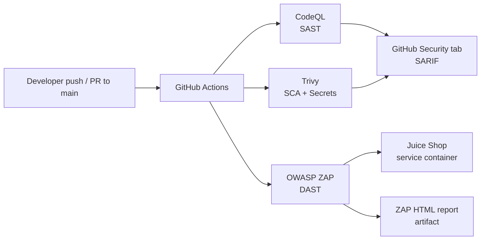

# 🔐 DevSecOps CI/CD Pipeline Security — MSc Thesis Project


Practical implementation from my MSc Cyber Security thesis at Arden University Berlin:
**"Security Analysis and Risk Mitigation in CI/CD DevSecOps Pipelines within Cloud-Based Software Development Environments."**

This project builds an automated security pipeline in **GitHub Actions** that tests an intentionally
vulnerable web application on every code change, combining **SAST, SCA, secret scanning and DAST**
to show how security can "shift left" into the development lifecycle.

---

## 🧱 Pipeline architecture



| Stage | Tool | Type | What it does | Trigger |
|---|---|---|---|---|
| 1 | **CodeQL** | SAST | Analyses JavaScript/TypeScript source code for security flaws | Push, PR, weekly |
| 2 | **Semgrep** | SAST | Rule-based static analysis (run locally, report in repo) | Manual |
| 3 | **Trivy** | SCA + Secret scanning | Scans dependencies for known CVEs (CRITICAL/HIGH) and detects hard-coded secrets | Push, PR, weekly |
| 4 | **OWASP ZAP** | DAST | Starts the app in a container and scans the running application from an attacker's perspective | Push, manual |

---

## 🎯 Target application

[OWASP Juice Shop](https://github.com/juice-shop/juice-shop) — an intentionally insecure web application
maintained by OWASP, used here **only as a test target** (`app/juice-shop`, MIT licence).
All credit for the application belongs to the OWASP Juice Shop project.

---

## 📊 Results — OWASP ZAP baseline scan (DAST)

**Summary:** 61 PASS · 7 WARN · 0 FAIL

| ZAP ID | Finding | Instances | Risk / remediation |
|---|---|---|---|
| 10038 | Content Security Policy (CSP) header not set | 5 | Increases XSS and data-injection risk → define a strict CSP header |
| 10049 | Storable and cacheable content | 7 | Sensitive responses may be cached → set `Cache-Control: no-store` where needed |
| 10063 | Deprecated Feature-Policy header | 5 | Replace with `Permissions-Policy` |
| 10098 | Cross-domain misconfiguration (CORS) | 5 | Overly permissive CORS → restrict allowed origins |
| 10109 | Modern web application | 5 | Informational: app relies on JavaScript; consider the AJAX spider for deeper coverage |
| 10110 | Dangerous JS functions | 1 | Use of risky functions such as `eval()` → review and refactor |
| 90004 | Insufficient site isolation against Spectre | 10 | Add `Cross-Origin-Resource-Policy` / COOP / COEP headers |

**Additional observation:** the scan surfaced internal server file paths (e.g. `fileServer.js`,
`node_modules/express/...`) and an exposed `/ftp` directory, which points to **information disclosure**
through verbose error handling and directory exposure.

The full HTML report is attached to each workflow run as the `zap-report` artifact.

## 📊 Results — SAST & SCA
- **CodeQL** and **Trivy** results are uploaded in SARIF format to the repository's **Security → Code scanning** tab.
- Scan reports are kept in this repository: `semgrep-report.json`, `trivy-report.html`, `trivy-report.json`, `trivy-report.txt`.

---

## ▶️ Run it locally

```bash
# 1. Start the target application
docker run -d -p 3000:3000 bkimminich/juice-shop

# 2. Dependency + secret scan
trivy fs --severity CRITICAL,HIGH ./app/juice-shop

# 3. Static analysis
semgrep --config auto ./app/juice-shop

# 4. DAST baseline scan
docker run --network host -t ghcr.io/zaproxy/zaproxy:stable zap-baseline.py -t http://localhost:3000
```

---

## 🧠 Key takeaways
- Layering SAST, SCA and DAST catches different classes of issue: no single tool covers everything.
- Running the target as a **service container** makes DAST repeatable inside CI.
- SARIF integration puts findings where developers already work (GitHub Security tab).
- Security headers (CSP, CORS, site isolation) were the most common DAST findings: cheap to fix, high value.

## 🛠️ Skills demonstrated
`DevSecOps` · `CI/CD security` · `GitHub Actions` · `SAST` · `SCA` · `DAST` · `Secret scanning` ·
`Docker` · `OWASP Top 10` · `Vulnerability analysis` · `Security reporting`

---

## ⚠️ Disclaimer
For educational and research purposes only. All testing is performed against a deliberately
vulnerable application in an isolated environment.

## 👤 Author
**Hassan Nadeem**, SOC Analyst | Threat Detection | DevSecOps
[GitHub](https://github.com/HassanNadeemCyberSec) · [LinkedIn](https://www.linkedin.com/in/hassan-nadeem-0b7729253)
